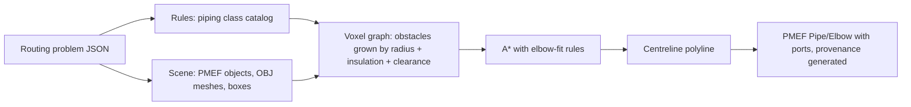

# Auto-routing kernel (`pmef-route`)

Status: first increment, 2026-11-25. Owner: PMEF (`docs/ECOSYSTEM.md`, decision 6).

## Goal

Route pipes (later cables) automatically: first in an abstract graph, then as PMEF geometry.
The kernel is decoupled from any viewer or CAD tool. It reads PMEF data and catalogs and writes
PMEF objects, so every consumer (PlantView, cad-engine, ProDocAimAi, EngineeringAI) uses the same
routing results without its own router.

## Why PMEF

The router needs the piping classes, pipe and fitting dimensions and the PMEF object model.
These live in PMEF, and dependencies in the ecosystem only point downwards. A separate repository
would duplicate the catalog access; cad-engine excludes domain logic such as piping classes.

## Pipeline



1. **Rules** (`rules.rs`). For the line's piping class and DN, the class catalog gives the outside
   diameter (pipe entry) and the 90° elbow (long radius preferred) with its centre-to-face. If a
   class has no `centreToFace_mm`, it is derived from the radius designation (`1.5D` etc.) and
   reported as a note. Design pressure and temperature are checked against the envelope stated in
   the class catalog. Full P/T rating curves remain DEXPI-Manager `pipe-class-engine` territory.
2. **Scene** (`scene.rs`). Obstacles come from PMEF packages (equipment `geometry.boundingBox`,
   `ParametricGeometry` primitives, steel members with catalog profile sizes, existing piping
   components via their ports), Wavefront OBJ meshes (e.g. IFC models converted with
   `tests/route/corpus/ifc2obstacles.py`) and explicit boxes. Nozzles of PMEF equipment become
   terminals (`<@id>#<nozzleMark>`). Obstacles are *hard* (never touched) or *soft* (walls, slabs:
   crossed straight at a penetration penalty, i.e. a sleeve or core drilling).
3. **Graph** (`grid.rs`). A rectilinear voxel graph over the region (terminals ± margin, or fixed
   bounds). Per-axis ticks are uniform at `step` plus the exact terminal coordinates, so both ends
   are exact graph nodes. Each node owns the cell between the mid-points to its neighbours. A node
   is blocked when its cell, grown by pipe radius + insulation + clearance, touches an obstacle
   (box test, or separating-axis triangle/box test for meshes). Because the cells tile space, thin
   walls between nodes are never jumped. Each route rasterises with its own diameter. Ticks never
   leave the region, so routes stay inside fixed bounds. Large meshes are sorted along a Morton curve into
   chunks of 64 triangles with bounding boxes, so a route only tests the triangles near its
   region. The straight stub in front of a terminal
   may only enter the clearance zone of the terminal's own equipment (`owner`, default: the
   nozzle's equipment); every other obstacle and every earlier line still blocks it.
   The stubs of all *other* lines (up to the far side of their first elbow) are reserved as
   obstacles, so an earlier line never runs directly in front of a later line's nozzle.
   **Pipe racks** (`racks`: axis, plan footprint, top-of-steel levels, `factor`, `shoeHeight`)
   pin a tick at each level's centreline elevation (top of steel + shoe + outer radius, the shoe
   at least the clearance) plus a guard tick 1 mm below it, so the beam leaves the level node
   free. Edges along the rack axis on a level cost `factor` (default 0.5) per mm: rack levels
   are preferred edges of the graph.
4. **Search** (`search.rs`). A flood fill first rejects enclosed terminals cheaply. Then A* over
   states (node, travel direction, has-bent, run-length bucket):
   - no reversal; turns are 90° elbows at nodes;
   - an elbow needs a straight run of at least `2 × centre-to-face` since the previous elbow and
     `centre-to-face + terminalStraight` from a terminal, so every catalog elbow physically fits;
   - no elbow inside a soft obstacle;
   - cost = length × zone factor (× vertical factor for vertical runs) + bend penalty + penetration
     penalty. Zones with factor < 1 express preferred corridors (pipe racks), > 1 areas to avoid.
   - admissible heuristic: Manhattan distance × lowest zone factor + a lower bound on the
     remaining bends.
5. **Geometry** (`pmef_out.rs`). Bend points become `pmef:Elbow` (catalog elbow, ports at
   ± centre-to-face), the gaps become `pmef:Pipe` (omitted when two elbows are welded face to
   face). Ports are chained with `connectedTo`. Each object carries `provenance.sourceType =
   "generated"`, `sourceRef = urn:pmef-route:<project>:<route>`, `review.status = "detected"` and
   a `WIP` revision: auto-routed lines are proposals until a person reviews them.

**Coarse-to-fine** (`grid.coarseStep`, `grid.corridor`). The line is routed on a coarse graph
first; obstacles within `corridor` of a terminal are left out there, because large cells would
block a nozzle. The fine graph is then built only over the coarse route grown by `corridor`
(default: `coarseStep`) and searched with all rules; nodes outside the corridor are blocked. If
the coarse or the corridor search fails (e.g. a gap narrower than a coarse cell), the full fine
graph is used, and the report notes which graph found the route. The corridor result is optimal
within the corridor, not necessarily over the whole region.

**Line rules** (stage 4). `straight` on a terminal (route end or branch consumer) sets the
straight length in front of it, e.g. pump suction or flow meter inlet, instead of
`settings.terminalStraight`. `tracing` on a route adds a radial heat-tracing allowance to
insulation. With `supports` (`maxSpan`, `reach`), pipe supports are placed on horizontal runs:
first where hard box obstacles (PMEF steel members) lie within `reach` below the pipe, then in
between so that no gap exceeds the maximum span and no run end is more than half a span from a
support; supports stay off elbows and tees. The default span is the ASME B31.1 Table 121.5
suggestion (water service) for the largest tabulated size not above the line's size. Output:
`pmef:PipeSupport` (`RESTING`, `structuralAttachmentId` when the steel is a PMEF object) with
one port at the bearing point (pipe bottom), pointing down.

**Branches** (`routes[].branches`: `id`, `to`). A line with several consumers is a tree: the
run `from`–`to` first, then each branch from its consumer to an equal tee of the class
(centre-to-end from the catalog, else ASME B16.9 with a note). The consumer nearest to the tree
goes next (greedy Steiner heuristic), and a branch may end on an earlier branch. The search
starts at the consumer; its goal is any node of the tree's straight runs that leaves room for
the tee (run centre-to-end + elbow centre-to-face from an elbow, + terminal straight from a
terminal, + branch centre-to-end from the tee a branch starts at, twice the centre-to-end from
another tee), reached perpendicular to the run. The tree's own clearance zone is entered only
straight and left only through the tee, so a branch never crosses its own line. Each branch
becomes its own `PipingSegment`; the `pmef:Tee` (`teeType: EQUAL`) connects its branch port
`P3` to the branch's first component. If a branch fails, the whole line fails (rip-up then
treats it like any other failed line). Example: `tests/route/header-branches-route.json`.

Lines are routed one after another; each routed line is an obstacle for the next. Then **rip-up
and reroute** (`settings.ripUpRounds`, default 5) repairs failures of the order: a failed line is
routed against the scene alone, the lines its route collides with are ripped up, the failed line
is routed first and the ripped-up lines are routed again around it. The new solution is kept if
it routes more lines, or as many at lower total cost; the report notes which lines were
re-routed. A line that fails without any other line (rules, terminals, scene) is not retried.

## Usage

```bash
cd pmef-rs
cargo run -p pmef-cli -- route ../tests/route/pump-skid-route.json -o /tmp/routed.ndjson \
  --report /tmp/route-report.json --plant urn:pmef:plant:eaf-2026:EAF-LINE-3
```

The corpus runs are reproducible with `tests/route/corpus/` (see its README).
The problem format is documented in `pmef-rs/pmef-route/src/problem.rs` (camelCase JSON).

## Results of the first increment

| Test | Scene | Lines | Result |
| --- | --- | --- | --- |
| `pmef-route` unit and integration tests | synthetic boxes, walls | 8 scenarios | L-route, clearance, elbow fit, sleeve, enclosed, class limits, second line avoids first, port chain |
| `tests/route/pump-skid-route.json` | `examples/pump-skid-complete.ndjson` (pump box, vessel primitives, steel, existing CW-201) | 3 (DN 25–200) | all routed; `examples/pump-skid-auto-routed.ndjson` passes schema, topology and geometry checks |
| plant-test-corpus Duplex (`Duplex_A` + `Duplex_Plumbing`) | 196 k vertices hard (existing plumbing, structure), walls/slabs soft | 4 hot-water lines boiler → fixtures | all routed, 4–6 bends, 0–2 slab penetrations, < 2.5 s per line (release) |
| plant-test-corpus Clinic (`Clinic_Structural` + `Clinic_Plumbing`) | 6 200 existing piping parts, 930 beams/columns, 140 MB OBJ; slabs/walls soft | 4 lines water heater → fixtures, 26–59 m, step 150 mm | all routed (3 × C5D1 incl. DN 25/40, 1 × A1A2), 3–5 bends, 0.1–7 s per line (release); before catalog C5D1 2024.3 the rule kernel rejected C5D1 DN 25/40 (no 90° elbow) |
| Duplex with `coarseStep` 500 (stage 1) | as above | 4 | all routed, 8.2 s → 1.6 s in total; length −1 % to +19 % per line (HW-103: one bend fewer) |
| Clinic with `coarseStep` 600 (stage 1) | as above | 4 | all routed, 14.0 s → 0.7 s in total; length −1 % to +3 % per line |
| `pmef-route` stage 1 tests | synthetic rack, wall with 400 mm gap | 3 | line climbs onto the rack level and runs 20 m along it; coarse-to-fine gives the fine optimum; fallback to the full graph for the narrow gap |
| `pmef-route` stage 2 test | plan-only scene, block with two corridors | 2 | sequentially L1 cuts L2 off; rip-up routes L2 first and L1 through the other corridor |
| `pmef-route` stage 3 tests, `tests/route/header-branches-route.json` | header DN 100 with 2–3 consumers, one box | 1 line, 3 branches | straight and bent branches end in tees on the header; the third consumer tees into the first branch; tee spacing kept; output passes schema, geometry and topology checks |
| `pmef-route` stage 4 tests | 20 m line over two beams; pump suction | 2 | supports on both beams plus fillers, no gap above 4.3 m (NPS 4); 1 000 mm straight before the suction is kept; header example with supports passes schema, geometry and topology checks |

## Later increments

1. **Plant-scale graphs.** Done in stage 1: rack levels as preferred edges, coarse-to-fine
   search with corridors, Morton-chunked triangle index, reserved terminal stubs. Open: Hanan /
   visibility graphs from obstacle boundaries instead of uniform ticks, octree occupancy so
   that very large regions do not need a dense node array.
2. **Multi-line negotiation.** Done in stage 2: rip-up and reroute of blocking lines. Open:
   PathFinder-style congestion costs over all lines at once (also to improve solutions without
   failures), packing of parallel lines into rack lanes with spacing tables (today the spacing
   follows from outer radii and clearance, quantised to the grid).
3. **Branches.** Done in stage 3: equal tees, greedy Steiner tree (nearest consumer first,
   branches may tee into branches). Open: reducing tees (branch DN below the run DN), optimal
   Steiner trees (Hanan grid, iterated 1-Steiner), headers routed through rack levels.
4. **More rules.** Done in stage 4: minimum straight lengths per terminal, heat-tracing
   allowance, support spacing and placement on steel. Open: slope for gravity lines (drains),
   45° elbows, skewed nozzles, valve accessibility and operating heights, flange/valve
   insertion from the class (the catalogs lack the weld-neck length through hub), guides and
   supports on vertical runs.
5. **Cables.** Same graph kernel with cable-tray networks and cable classes (bend radius, fill
   ratio, segregation of power and signal) instead of piping classes; output as PMEF E&I objects.
6. **Integration.** WASM build for ProDocAimAi and PlantView, interactive re-routing in the
   viewers, DEXPI line lists as input (DEXPI-Manager `dexpi-pmef` gives line, class, DN and
   connected nozzles via stable `@id`s).
