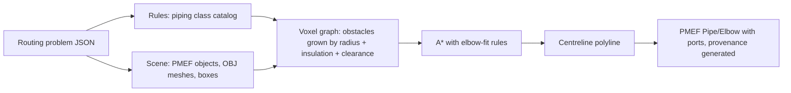

# Auto-routing kernel (`pmef-route`)

Status: first increment, 2026-11-25. Owner: PMEF (`docs/ECOSYSTEM.md`, decision 6).

## Goal

Route pipes (later cables) automatically: first in an abstract graph, then as PMEF geometry.
The kernel is decoupled from any viewer or CAD tool. It reads PMEF data and catalogs and writes
PMEF objects, so every consumer (PlantView, cad-engine, ProDocAimAi, EngineeringAI) uses the same
routing results without its own router.

## Why PMEF

The router needs the piping classes, pipe and fitting dimensions and the PMEF object model.
These live in PMEF, and dependencies in the ecosystem only point downwards. A separate repository
would duplicate the catalog access; cad-engine excludes domain logic such as piping classes.

## Pipeline



1. **Rules** (`rules.rs`). For the line's piping class and DN, the class catalog gives the outside
   diameter (pipe entry) and the 90° elbow (long radius preferred) with its centre-to-face. If a
   class has no `centreToFace_mm`, it is derived from the radius designation (`1.5D` etc.) and
   reported as a note. Design pressure and temperature are checked against the envelope stated in
   the class catalog. Full P/T rating curves remain DEXPI-Manager `pipe-class-engine` territory.
2. **Scene** (`scene.rs`). Obstacles come from PMEF packages (equipment `geometry.boundingBox`,
   `ParametricGeometry` primitives, steel members with catalog profile sizes, existing piping
   components via their ports), Wavefront OBJ meshes (e.g. IFC models converted with
   `tests/route/corpus/ifc2obstacles.py`) and explicit boxes. Nozzles of PMEF equipment become
   terminals (`<@id>#<nozzleMark>`). Obstacles are *hard* (never touched) or *soft* (walls, slabs:
   crossed straight at a penetration penalty, i.e. a sleeve or core drilling).
3. **Graph** (`grid.rs`). A rectilinear voxel graph over the region (terminals ± margin, or fixed
   bounds). Per-axis ticks are uniform at `step` plus the exact terminal coordinates, so both ends
   are exact graph nodes. Each node owns the cell between the mid-points to its neighbours. A node
   is blocked when its cell, grown by pipe radius + insulation + clearance, touches an obstacle
   (box test, or separating-axis triangle/box test for meshes). Because the cells tile space, thin
   walls between nodes are never jumped. Each route rasterises with its own diameter.
4. **Search** (`search.rs`). A flood fill first rejects enclosed terminals cheaply. Then A* over
   states (node, travel direction, has-bent, run-length bucket):
   - no reversal; turns are 90° elbows at nodes;
   - an elbow needs a straight run of at least `2 × centre-to-face` since the previous elbow and
     `centre-to-face + terminalStraight` from a terminal, so every catalog elbow physically fits;
   - no elbow inside a soft obstacle;
   - cost = length × zone factor (× vertical factor for vertical runs) + bend penalty + penetration
     penalty. Zones with factor < 1 express preferred corridors (pipe racks), > 1 areas to avoid.
   - admissible heuristic: Manhattan distance × lowest zone factor + a lower bound on the
     remaining bends.
5. **Geometry** (`pmef_out.rs`). Bend points become `pmef:Elbow` (catalog elbow, ports at
   ± centre-to-face), the gaps become `pmef:Pipe` (omitted when two elbows are welded face to
   face). Ports are chained with `connectedTo`. Each object carries `provenance.sourceType =
   "generated"`, `sourceRef = urn:pmef-route:<project>:<route>`, `review.status = "detected"` and
   a `WIP` revision: auto-routed lines are proposals until a person reviews them.

Lines are routed one after another; each routed line is an obstacle for the next.

## Usage

```bash
cd pmef-rs
cargo run -p pmef-cli -- route ../tests/route/pump-skid-route.json -o /tmp/routed.ndjson \
  --report /tmp/route-report.json --plant urn:pmef:plant:eaf-2026:EAF-LINE-3
```

The corpus runs are reproducible with `tests/route/corpus/` (see its README).
The problem format is documented in `pmef-rs/pmef-route/src/problem.rs` (camelCase JSON).

## Results of the first increment

| Test | Scene | Lines | Result |
| --- | --- | --- | --- |
| `pmef-route` unit and integration tests | synthetic boxes, walls | 8 scenarios | L-route, clearance, elbow fit, sleeve, enclosed, class limits, second line avoids first, port chain |
| `tests/route/pump-skid-route.json` | `examples/pump-skid-complete.ndjson` (pump box, vessel primitives, steel, existing CW-201) | 3 (DN 25–200) | all routed; `examples/pump-skid-auto-routed.ndjson` passes schema, topology and geometry checks |
| plant-test-corpus Duplex (`Duplex_A` + `Duplex_Plumbing`) | 196 k vertices hard (existing plumbing, structure), walls/slabs soft | 4 hot-water lines boiler → fixtures | all routed, 4–6 bends, 2 slab penetrations each, < 2.5 s per line (release) |
| plant-test-corpus Clinic (`Clinic_Structural` + `Clinic_Plumbing`) | 6 200 existing piping parts, 930 beams/columns, 140 MB OBJ; slabs/walls soft | 4 lines water heater → fixtures, 26–59 m, step 150 mm | all routed, 3–5 bends, 0.1–7.6 s per line (release); the rule kernel rejected C5D1 DN 25/40 because that class has no 90° elbow for these sizes |

## Later increments

1. **Plant-scale graphs.** Sparse graphs instead of a full voxel grid: pipe-rack networks
   (rack levels as preferred edges), Hanan / visibility graphs from obstacle boundaries, octree
   occupancy for large models. Coarse-to-fine search (route on 500 mm, refine near terminals).
2. **Multi-line negotiation.** Rip-up and reroute (PathFinder-style congestion costs) instead of
   strict sequential order; grouping of parallel lines on racks with spacing tables.
3. **Branches.** Tees and Steiner-tree routing for headers with several consumers.
4. **More rules.** Slope for gravity lines (drains), 45° elbows, skewed nozzles, minimum straight
   lengths before instruments and pumps, valve accessibility and operating heights, insulation
   and heat-tracing allowances, flange/valve insertion from the class, support spacing and
   placement on steel.
5. **Cables.** Same graph kernel with cable-tray networks and cable classes (bend radius, fill
   ratio, segregation of power and signal) instead of piping classes; output as PMEF E&I objects.
6. **Integration.** WASM build for ProDocAimAi and PlantView, interactive re-routing in the
   viewers, DEXPI line lists as input (DEXPI-Manager `dexpi-pmef` gives line, class, DN and
   connected nozzles via stable `@id`s).
